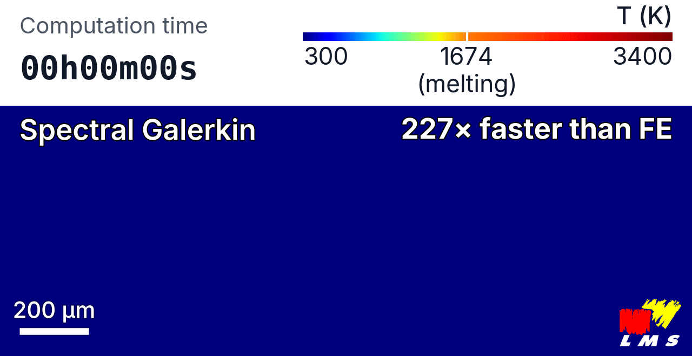

# spectral_galerkin_heat

**A semi-analytical, modal solver for the fully nonlinear heat equation on cuboid domains, with CPU/GPU backends and G-code-driven laser paths.**

[](https://opensource.org/licenses/Apache-2.0)
[](https://doi.org/10.5281/zenodo.23343133)
[](https://arxiv.org/abs/2609.22268)
[](https://theo-andrieux.github.io/sgh-docs/)

<p align="center">
  
  <br>
  <em>A laser scan simulated with spectral_galerkin_heat; the clock shows the computation time on one GPU.</em>
</p>

On a single-pass laser scan, the solver stays within 0.67% (relative L² error) of a high-fidelity finite element reference. On one CPU core it runs 6.2 times faster than the finite element model while using about ten times more degrees of freedom, and 227 times faster on a GPU. Temperature-dependent properties, latent heat, evaporation and surface fluxes are all included.

## What it does

`spectral_galerkin_heat` solves transient heat transfer on cuboid domains under laser scanning, as in laser surface treatment and metal additive manufacturing. The heat equation is split into a linear, constant-coefficient reference operator, integrated analytically in a spectral eigenbasis, and a nonlinear forcing term (temperature-dependent properties, latent heat, surface fluxes) resolved by fixed-point iteration. This avoids the global algebraic solve of an implicit finite element step, and maps naturally onto GPUs.

- Laser paths read directly from G-code
- CPU (NumPy) and GPU (CuPy) backends
- Results written as HDF5/XDMF, ready for ParaView

The [validation page](https://theo-andrieux.github.io/sgh-docs/validation.html) has the full comparison with finite elements, and the [theory page](https://theo-andrieux.github.io/sgh-docs/theory.html) the derivation.

## Quickstart

The code is installed from source (it is not on PyPI). The recommended tool is [`uv`](https://github.com/astral-sh/uv), which creates an isolated environment with all dependencies; install it with `curl -LsSf https://astral.sh/uv/install.sh | sh` if needed.

```bash
git clone https://github.com/theo-andrieux/spectral_galerkin_heat.git
cd spectral_galerkin_heat

uv sync                 # CPU only
# uv sync --group gpu   # GPU backend, requires CUDA 13.x

uv run python simulations/main.py simulations/examples/01_quickstart.yaml
```

Results are saved to `out/<timestamp>_<name>/` in HDF5/XDMF format. `uv run` executes inside the managed environment, so there is no separate install step. If your shell does not pick up the environment, prefix commands with `uv run` as above.

## Examples

The solver runs either from the command line (`simulations/main.py` with a `.yaml` configuration) or as a Python library. The examples in [`simulations/examples/`](simulations/examples/) go from the simplest case to the full nonlinear one:

| Example | What it shows |
| --- | --- |
| [`01_quickstart.yaml`](simulations/examples/01_quickstart.yaml) | Single laser track on a 316L cuboid, constant properties, evaporation only. Runs in seconds. |
| [`02_single_track.yaml`](simulations/examples/02_single_track.yaml) | Same track with latent heat of fusion and surface convection switched on. |
| [`03_nonlinear_tdep.yaml`](simulations/examples/03_nonlinear_tdep.yaml) | Temperature-dependent properties: Picard iteration with a global property correction. |
| [`orchestrator.py`](simulations/examples/orchestrator.py) | Library mode: build a `SimulationContext` from a Python dictionary and call `solver.step(...)` directly. |

The [documentation](https://theo-andrieux.github.io/sgh-docs/) has a tutorial for each example and the full configuration reference.

## Installation details

**Prerequisites:** Python 3.12 or newer, and [`uv`](https://github.com/astral-sh/uv) (recommended; plain `pip` also works). The GPU backend additionally needs an NVIDIA GPU with the CUDA 13.x toolkit installed system-wide; the CPU backend needs nothing extra.

`uv sync` installs the CPU core. Extras are added with `--group`:

| Command | Adds |
| --- | --- |
| `uv sync` | CPU core (default; enough to run the examples) |
| `uv sync --group gpu` | CuPy GPU backend *(requires system CUDA 13.x)* |
| `uv sync --group docs` | Sphinx toolchain to build the docs |
| `uv sync --group dev` | Test and lint tooling (`pytest`, `ruff`) |
| `uv sync --all-groups` | Everything above |

<details>
<summary>Installing with pip instead of uv</summary>

From the repository root, in an environment you manage yourself:

```bash
python -m pip install -e .            # CPU core
python -m pip install -e ".[gpu]"     # + GPU backend (needs system CUDA 13.x)
python -m pip install -e ".[docs]"    # + docs toolchain
```
</details>

<details>
<summary>Building the documentation locally</summary>

```bash
uv sync --group docs
uv run make -C docs html      # Output: docs/_build/html/index.html
```
</details>

## Citation

If you use this code in your research, please cite the paper:

> T. Andrieux, A. Ntinos, M. V. Upadhyay, *Efficient spectral Galerkin framework for nonlinear transient heat transfer in finite domains*, arXiv:2609.22268 (2026). https://arxiv.org/abs/2609.22268

```bibtex
@misc{andrieux2026spectral,
  title         = {Efficient spectral Galerkin framework for nonlinear transient heat transfer in finite domains},
  author        = {Andrieux, Th{\'e}o and Ntinos, Andreas and Upadhyay, Manas V.},
  year          = {2026},
  eprint        = {2609.22268},
  archivePrefix = {arXiv},
  primaryClass  = {cond-mat.mtrl-sci},
  doi           = {10.48550/arXiv.2609.22268},
  url           = {https://arxiv.org/abs/2609.22268}
}
```

To cite the software itself, cite the version you used: v1.0.0 is [10.5281/zenodo.23343134](https://doi.org/10.5281/zenodo.23343134). GitHub's "Cite this repository" button reads [`CITATION.cff`](CITATION.cff).

## Developers

Théo Andrieux *(main developer)* \
Jules Dichamp \
Manas V. Upadhyay

Laboratoire de Mécanique des Solides (LMS), École Polytechnique, Institut Polytechnique de Paris, CNRS UMR 7649, Route de Saclay, 91128 Palaiseau, France.

## License

Licensed under the Apache License, Version 2.0; see [LICENSE](LICENSE).

Copyright © 2026 Laboratoire de Mécanique des Solides (LMS), École Polytechnique, CNRS UMR 7649, Institut Polytechnique de Paris, Route de Saclay, Palaiseau, 91128, France.

## Acknowledgements

This work was supported by the Agence de l'innovation de défense (AID) via the Centre Interdisciplinaire d'Études pour la Défense et la Sécurité (CIEDS), project 2025 - LaserSurf, and by the French Agence Nationale de la Recherche (ANR) under grant ANR-24-CE08-3737.
